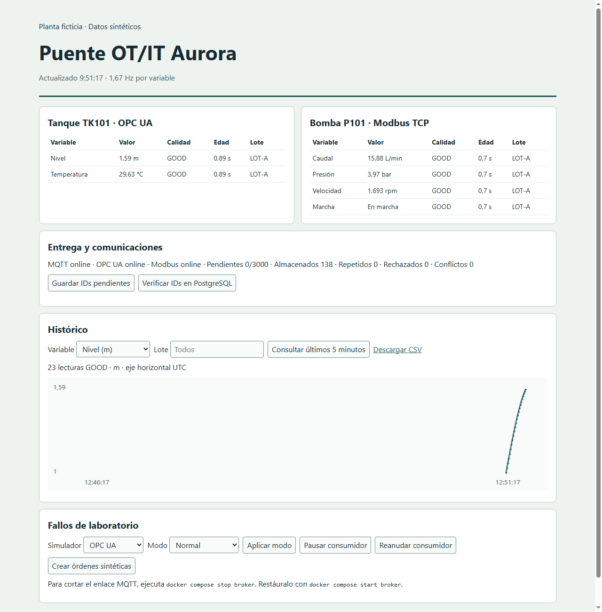
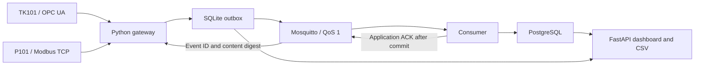

# Industrial Data Bridge

A local, reproducible OT/IT lab for a fictional plant. It reads a tank over OPC UA and a pump over Modbus TCP, normalizes quality and time, and buffers events in SQLite before sending them to Mosquitto. PostgreSQL stores the original event and the production-order context. The Spanish dashboard shows acquisition quality, backlog and the IDs of recovered events.

## Quickstart

Prerequisites are Python 3.12.13, uv 0.11.19, and Docker Engine with Compose v2. The first run downloads pinned Python dependencies and versioned images.

```sh
uv sync --locked
uv run python scripts/init_demo.py
docker compose config --quiet
docker compose up --build -d
```

Open [the local dashboard](http://127.0.0.1:8000), create the synthetic orders, and follow the [Spanish demonstration](docs/GUIA.md). Stop the stack with `docker compose down`. Compose keeps the PostgreSQL and SQLite volumes for the next run.



## Configure an authorized source

Copy [the alternate Modbus map](config/acquisition.example.toml) and edit the
destination allowlist, source, asset and variable definitions. The example
reads holding register zero on port 2502, independently of the demo's pump.
Provide a PostgreSQL database, Mosquitto users with per-role ACLs, and the
environment variables referenced by the profile.

```sh
uv run python -m bridge validate --config config/acquisition.example.toml
uv run python -m bridge diagnose --config config/acquisition.example.toml
uv run python -m bridge probe --config config/acquisition.example.toml --source medidor_b
uv run python -m bridge consumer --config config/acquisition.example.toml
uv run python -m bridge gateway --config config/acquisition.example.toml
BRIDGE_CONFIG=config/acquisition.example.toml uv run uvicorn bridge.api:app --host 127.0.0.1 --port 8000
```

Run the last three commands in separate terminals. The acquisition profile
supports read-only Modbus TCP and OPC UA in a controlled lab or pilot. See the
[Spanish guide](docs/GUIA.md#fuente-propia-autorizada) for TLS, broker ACLs,
querying, export, backups and operation.

## Delivery



The delivery contract covers events already persisted in the outbox. Broker disconnects may cause replays. PostgreSQL deduplicates by immutable event ID and records conflicting content. A simulator disconnect creates explicit bad readings with null values, and exhausted outbox capacity creates a coverage gap.

The native Windows run recovered all 2,000 buffered event IDs in 45.83 seconds. A separate live sample of 126 events measured 0.317 s p95 from acquisition to PostgreSQL commit at 10.29 events/s.

## Verification

```sh
uv run ruff check
uv run ruff format --check
uv run pytest -m "not integration"
uv run pytest tests/test_acquisition.py -m integration
```

The [validation report](docs/VALIDACION.md) gives observed results and the real-service command. See the [technical guide in Spanish](docs/GUIA.md) for the protocol map, event and ACK contracts, failure behavior and interview notes. Data are synthetic and the security profile is for a local lab. [Licenses and provenance](docs/PROCEDENCIA.md).
